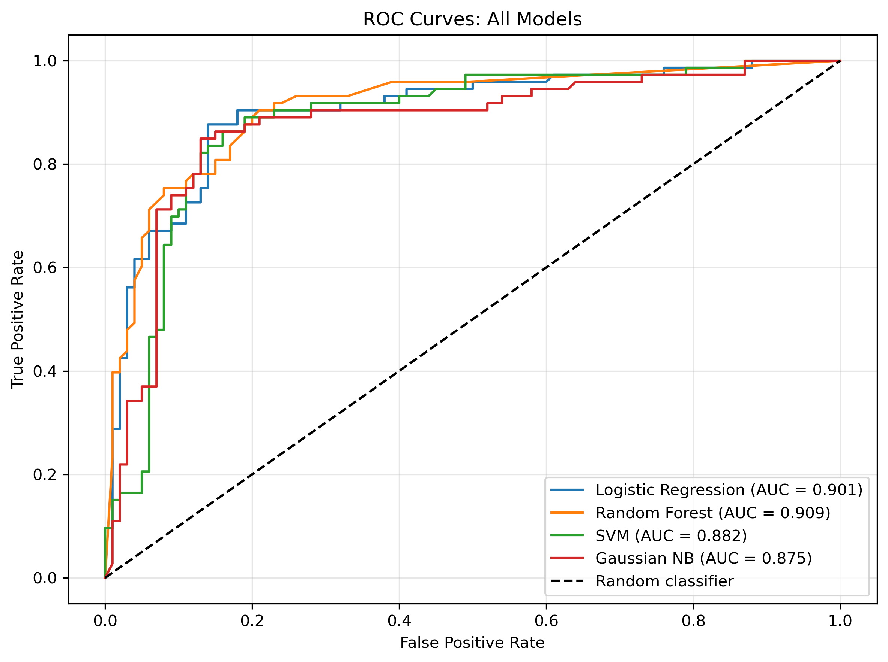
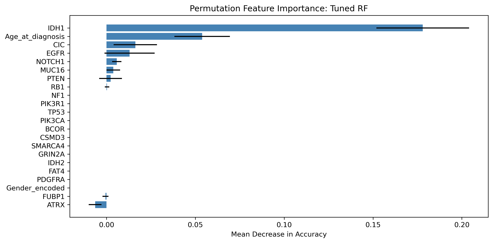

# Glioma grade classification from tumour mutations

AI as a Medical Device module, MSc AI for Healthcare, University of Hull, 2026. Module mark: 85%.

I built a classifier that separates lower-grade glioma (LGG) from glioblastoma (GBM) using a small panel of gene mutations, and chose the final model on the error that matters clinically: a missed glioblastoma. Logistic regression on a 10-gene panel caught 64 of 73 glioblastomas in the held-out test set (sensitivity 0.88, specificity 0.83, AUC 0.90).

## The clinical question

Glioblastoma is the aggressive grade. A patient with GBM who is classified as LGG risks being treated as if the tumour were slow-growing, so a false negative costs far more than a false positive. Accuracy alone hides that difference: two models with similar accuracy can miss very different numbers of cancers. Sensitivity for GBM was therefore the primary metric, with specificity and AUC alongside it.

## What I built

- **Data:** 861 patients from the TCGA LGG and GBM projects, 20 mutation markers plus age at diagnosis and gender. GBM is the positive class.
- **Leak-free pipeline:** feature selection (SelectKBest, chi-squared) and scaling sit inside a scikit-learn `Pipeline`, so they are refitted within every cross-validation fold and never see the test set.
- **Panel size as a clinical decision:** 12 genes gave 0.875 cross-validated accuracy and 10 genes gave 0.866. I kept 10, because every extra gene is another laboratory test per patient and a difference of 0.009 is not clinically meaningful.
- **Models compared:** logistic regression, random forest (baseline, then tuned with GridSearchCV), support vector machine (SVM) and Gaussian Naive Bayes.
- **Beyond the score:** decision threshold analysis, permutation importance and a review of the misclassified patients.

## Results on the held-out test set (173 patients, 73 with GBM)

| Model | Accuracy | Sensitivity (GBM) | Specificity | AUC |
|---|---|---|---|---|
| **Logistic regression** | **0.85** | **0.88** | **0.83** | **0.90** |
| Random forest | 0.82 | 0.78 | 0.85 | 0.91 |
| SVM | 0.83 | 0.86 | 0.81 | 0.88 |
| Gaussian Naive Bayes | 0.69 | 0.90 | 0.54 | 0.88 |



**Why logistic regression.** Naive Bayes caught slightly more glioblastomas, but it flagged almost half of the low-grade patients as GBM, which would send many patients for unnecessary escalation. Tuning the random forest raised its sensitivity from 0.78 to 0.86, level with the SVM but not beyond logistic regression. Logistic regression gave the best balance of sensitivity and specificity, and its decisions can be explained to a clinical team through its coefficients.

**Operating point.** Lowering the logistic regression threshold from 0.5 to 0.3 raised sensitivity to 0.90 and reduced specificity to 0.79. The notebook reports the full trade-off, because the right threshold is a decision for the clinical team, based on how they weigh a missed GBM against an unnecessary referral.



## From model to medical device

The module also required a translational strategy for deploying this classifier in the NHS. I wrote an evidence generation plan covering intended use, stakeholder engagement, the MHRA software as a medical device pathway, bias and equity, implementation, health economics and post-market surveillance. Post-market surveillance for software follows the same logic as pharmacovigilance for medicines: the evidence does not stop at approval.

## Running it

```bash
pip install -r requirements.txt
jupyter notebook tcga_glioma_grading.ipynb
```

The data is not included. The notebook reads `tcga_glioma_2026.csv`, the module's copy of the public UCI dataset [Glioma Grading Clinical and Mutation Features](https://archive.ics.uci.edu/dataset/759). Download it and save it next to the notebook under that name. The public version may differ slightly from the module copy.

## What I learned

- Feature selection belongs inside the pipeline. Selecting features on the full dataset first leaks test information into training and inflates every score.
- `LabelEncoder` sorts classes alphabetically, which inverted my positive class in an early version. GBM has to be class 1, or the reported sensitivity belongs to the wrong tumour.
- The model choice is a clinical decision as much as a statistical one.

## Related

[wbc-breast-cancer-classification](https://github.com/maryclovers/wbc-breast-cancer-classification), my laboratory notebook from the same module.

Clovers Akitoye · [GitHub](https://github.com/maryclovers) · [LinkedIn](https://www.linkedin.com/in/cloversakitoye)
